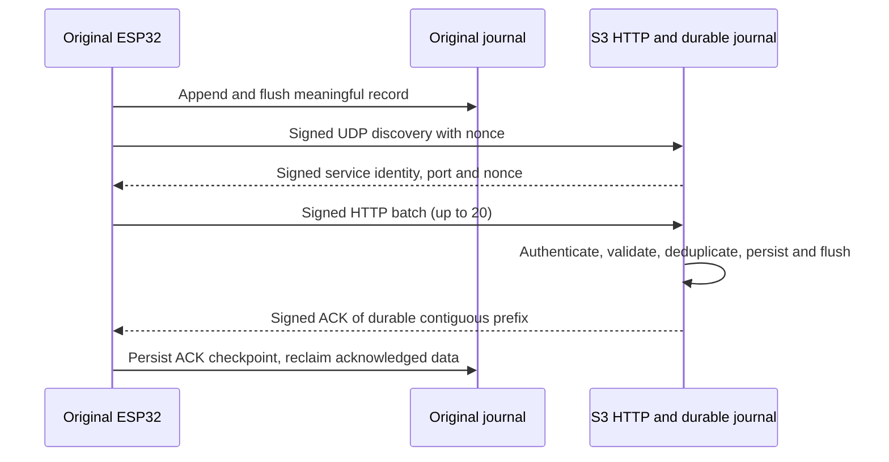

# Local HTTP telemetry

Status: **software implementation complete; hardware validation pending**. Focused host tests and firmware builds pass, but an end-to-end LAN exchange, power-loss behavior on device LittleFS and installed partition compatibility remain unverified. The S3 has no Cloudflare firmware forwarding; its local journal is bounded and has no drain. Do not treat these branches as hardware-validated.

Run the focused host checks with `python3 tests/run_http_checks.py`; it fails if any expected test is missing. For local testing, the S3 journal retains all durably accepted records and has no cloud drain. Once its configured 60,000-record limit or filesystem reserve is reached, the endpoint rejects new records; the original keeps unacknowledged records and reports queue exhaustion. Do not erase acknowledged records to create space or represent this as cloud delivery. Capacity and endurance on the actual formatted filesystem are unverified.

## Verified source baseline

The original `led_bench` image samples DS18B20 and updates its LED-only valve
simulation in the control loop while separate aggregation and delivery tasks
persist and send local telemetry. The S3 reuses its STA-bound `BoilerWeb`
server on port 80 for challenge and telemetry endpoints and retains local
login, CSRF and Tuya status/control. Authenticated UDP discovery uses port
40173. The removed local WSS implementation was independent of future cloud
or browser WebSockets; the S3 firmware still has no Cloudflare client.

## Binary record v1

`http_telemetry_record.hpp` is identical in the two firmware trees. The packed little-endian record is **42 bytes**, including CRC32 over the preceding 38 bytes. It carries version, sensor validity and clock validity flags, valve code, fault indicators, a provisioned stable 64-bit device identifier, random 64-bit per-boot nonce, 32-bit sequence, 32-bit monotonic uptime in milliseconds, signed centi-degree readings, UTC epoch seconds when synchronized (zero otherwise), 16-bit diagnostic field and CRC. The tuple `(device_id, boot_nonce, sequence)` is the record identity. Boot nonce must come from the hardware random generator; nonzero and collision testing are mandatory. Sequence wrap must rotate the nonce before reuse. The same identity is required for S3 deduplication and ACKs.

Unknown temperature values are represented by cleared validity bits; a receiver rejects out-of-range valid temperatures, inconsistent clock flags, unsupported flags, wrong device and CRC errors. Sensor and valve evidence remain separate: a valve code is an inferred controller state, never measured physical position.
Valve codes are 0 UNKNOWN, 1 INTERLOCK, 2 OPENING, 3 CLOSING, 4 OPEN_ASSUMED, 5 CLOSED_ASSUMED and 6 FAULT. Fault bits are role/configuration failure (bit 0) and controller failure (bit 1). The 16-bit diagnostic field is reserved for the lower 16 bits of the controller transition counter; its wrap is informational, not identity.

At 3 seconds, 28,800 records/day × 42 bytes = **1,209,600 bytes/day** before filesystem metadata, checkpoints and safety reserve. The original default partition is 1,441,792 bytes, so the theoretical headroom is 232,192 bytes. This is **not** a 24-hour retention guarantee; usable LittleFS capacity, segmentation, write amplification and existing partition contents have not been measured. If the existing filesystem cannot be mounted without formatting, firmware must fail closed and preserve the partition. No automatic format, erase or resize is authorized.

## Delivery contract and boundary

The original appends and flushes each complete record before delivery. It discovers the dedicated S3 service using versioned HMAC-authenticated UDP broadcast on port 40173, distinct from the Tuya proxy's UDP 6000. HTTP `POST /api/v1/telemetry` reuses the S3's local port 80 server; a fixed buffer limits each batch to 20 records. A short-lived challenge nonce provides request replay protection. HMAC-SHA256 covers the exact batch header and records; the header binds protocol version, stable device ID, sender boot, uptime and challenge. The S3 verifies framing, MAC and challenge before accepting records. The signed response binds that challenge and the last identity in the contiguous accepted prefix. A valid ACK removes only that prefix; malformed, interrupted, missing or mismatched ACKs leave records queued. Provision the shared key through ignored local configuration, independently from the Tuya key. Plain HTTP provides integrity/authentication but no confidentiality from LAN observers.

The S3 persistence boundary is its fsynced local journal and recovered deduplication state. It sends an ACK only after each named record is present there. The current local-test mode has no journal drain: at 60,000 records or when the 8 KiB filesystem reserve is reached, the S3 returns a storage rejection and the original retains its unacknowledged prefix. This is not cloud delivery. The TFT uses only a record generated in the current sender boot and within 30 seconds of the request uptime; historical backlog remains durable but cannot overwrite the live measurement. Communication is LIVE through 35 seconds after telemetry or heartbeat, DELAYED through 75 seconds, then OFFLINE. Measurement freshness is tracked separately with LIVE, DELAYED and STALE states.

## Diagnostics and recovery checklist

- Discovery failure: inspect STA readiness, subnet broadcast, dedicated port, identity and MAC rejection counts. Do not fall back to a hardcoded IP or the Tuya proxy.
- HTTP unavailable: inspect S3 STA-bound port 80 availability and whether setup AP is active. Do not expose this route through Cloudflare.
- Backlog growth: inspect pending count, oldest age, filesystem free bytes, overflow count and last ACK; retain records on failure.
- ACK failure: compare request nonce, batch prefix identities, response MAC and durable checkpoint result. Retry with backoff and jitter; never delete by HTTP status alone.
- Authentication failure: verify provisioned identities and key rotation state without printing keys or payload MACs.
- TFT STALE: compare source generation time, age, sequence and backlog status. A newly received old item remains historical.
- Queue full: the S3 returns no durable ACK for unaccepted records; inspect its bounded journal before any separately designed drain or migration. Never erase it to simulate forwarding.

## Verification status

The explicit host runners pass record, HMAC, discovery validation, replay, malformed framing, timeout configuration, interrupted ACK, journal recovery, queue-full, duplicate/restart, lost-ACK, reporting and TFT freshness checks. Both migrated PlatformIO images build. Host tests reuse the production protocol, journal and acceptance components, while Arduino `HTTPClient`, `WebServer` and `WiFiUDP` behavior is limited to compile and call-site checks. No hardware upload, serial monitoring, live HTTP exchange, flash-capacity test or soak was performed.
