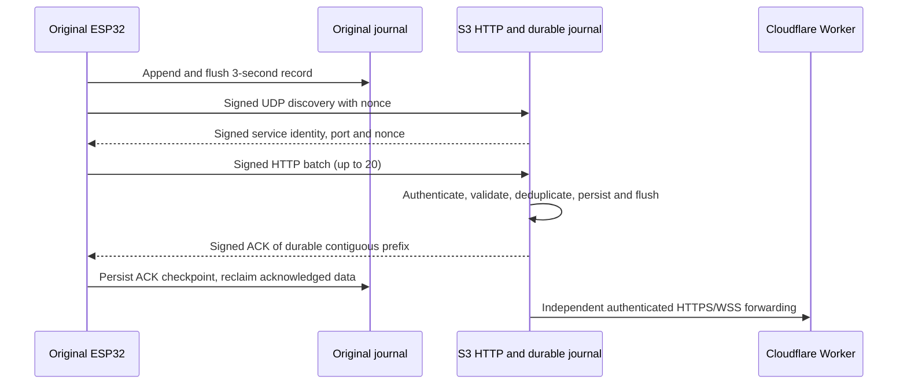

# Local HTTP telemetry migration draft

Status: **protocol record implemented and host tested; transport, durable queues, discovery, Cloudflare firmware forwarding, and TFT conversion remain open**. Do not flash these branches as a migrated pair.

## Verified source baseline

The original `led_bench` image (ESP32 `esp32dev`) uses `BenchWss` from a separate task while its loop samples DS18B20, updates the LED-only valve simulation and reports diagnostics. The S3 `esp32-s3-n16r8-tft` image has a local WSS receiver at 9443 and a separate STA-bound `BoilerWeb` server at HTTP port 80. The latter retains local login, CSRF and Tuya status/control. Neither image has a persistent telemetry queue. The S3 firmware has no Cloudflare client. The Worker in this repository currently offers `/device/v1/:deviceId/ws`, which uses outbound-from-S3 authenticated WSS in the proposed cloud flow; browser streams use separate WebSockets. The local HTTP migration must not remove these cloud/browser contracts.

## Binary record v1

`http_telemetry_record.hpp` is identical in the two firmware trees. The packed little-endian record is **42 bytes**, including CRC32 over the preceding 38 bytes. It carries version, sensor validity and clock validity flags, valve code, fault indicators, a provisioned stable 64-bit device identifier, random 64-bit per-boot nonce, 32-bit sequence, 32-bit monotonic uptime in milliseconds, signed centi-degree readings, UTC epoch seconds when synchronized (zero otherwise), 16-bit diagnostic field and CRC. The tuple `(device_id, boot_nonce, sequence)` is the record identity. Boot nonce must come from the hardware random generator; nonzero and collision testing are mandatory. Sequence wrap must rotate the nonce before reuse. The same identity is required for S3 deduplication and ACKs.

Unknown temperature values are represented by cleared validity bits; a receiver rejects out-of-range valid temperatures, inconsistent clock flags, unsupported flags, wrong device and CRC errors. Sensor and valve evidence remain separate: a valve code is an inferred controller state, never measured physical position.

At 3 seconds, 28,800 records/day × 42 bytes = **1,209,600 bytes/day** before filesystem metadata, checkpoints and safety reserve. The original default partition is 1,441,792 bytes, so the theoretical headroom is 232,192 bytes. This is **not** a 24-hour retention guarantee; usable LittleFS capacity, segmentation, write amplification and existing partition contents have not been measured. If the existing filesystem cannot be mounted without formatting, firmware must fail closed and preserve the partition. No automatic format, erase or resize is authorized.

## Proposed delivery contract and boundary

The original must append and flush each complete record before delivery. It discovers a dedicated S3 service using versioned authenticated UDP broadcast on a port distinct from the Tuya proxy's UDP 6000. HTTP `POST /api/v1/telemetry` reuses the S3's local port 80 server; batches contain at most 20 records. Each request must bind the HMAC-SHA256 to protocol version, stable device ID, a unique request nonce, exact body bytes and endpoint. The S3 must verify before parsing or accepting and reject replayed request nonces or use idempotent record identities to make replay harmless. The response must be authenticated and bind the request nonce and exact contiguous accepted record identities. A valid ACK removes only that prefix; malformed, missing or mismatched ACKs leave all records queued. Provision the shared key through ignored local configuration, independently from the Tuya key. Plain HTTP provides integrity/authentication through the MAC but no confidentiality from LAN observers.

The S3 persistence boundary is its local durable journal and deduplication state, flushed before ACK. Its cloud forwarding worker drains that journal independently, so a Cloudflare outage cannot reject local telemetry solely because cloud is unavailable. Cloud delivery remains at least once unless the existing Worker can prove an end-to-end idempotent durable acknowledgement for each record. The TFT uses only the newest generation, not reception time of an old backlog item. With trusted generation age, health is LIVE through 7 s, DELAYED through 15 s, STALE through 30 s, then OFFLINE; no sample is UNKNOWN. Untrusted generation age is conservatively OFFLINE. A delayed historical record cannot make the screen LIVE.

## Diagnostics and recovery checklist

- Discovery failure: inspect STA readiness, subnet broadcast, dedicated port, identity and MAC rejection counts. Do not fall back to a hardcoded IP or the Tuya proxy.
- HTTP unavailable: inspect S3 STA-bound port 80 availability and whether setup AP is active. Do not expose this route through Cloudflare.
- Backlog growth: inspect pending count, oldest age, filesystem free bytes, overflow count and last ACK; retain records on failure.
- ACK failure: compare request nonce, batch prefix identities, response MAC and durable checkpoint result. Retry with backoff and jitter; never delete by HTTP status alone.
- Authentication failure: verify provisioned identities and key rotation state without printing keys or payload MACs.
- TFT STALE: compare source generation time, age, sequence and backlog status. A newly received old item remains historical.
- Cloudflare unavailable: inspect independent forwarding queue and Worker authentication; local reception and Tuya safety remain separate.

## Verification status

Portable record tests pass in both repositories. Baseline PlatformIO builds pass using links to existing ignored local configuration; no new transport code is in those images. No hardware upload, serial monitoring, live HTTP exchange, cloud deployment, flash capacity test or soak was performed for this migration.
