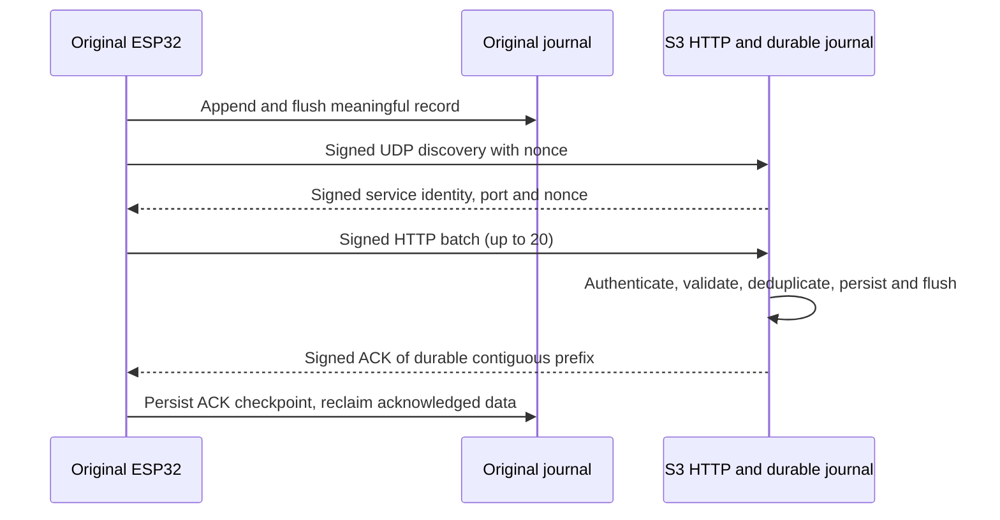

# Local ESP-NOW telemetry with HTTP fallback

Status: **paired hardware tests passed; uninterrupted 30-minute soak in progress** (2026-10-29). The original sends authenticated ESP-NOW over a direct encrypted peer as its primary path, without router association. Its existing authenticated HTTP client is the secondary path. Both paths share the same durable record identity and S3 journal. Installed partitions and app slots, filesystem mounts without formatting, app-only flash read-back, direct delivery, fallback, recovery, and restart were checked on the physical boards. The S3 has no Cloudflare firmware forwarding; its local journal is bounded and has no drain. The paired evidence and final soak result are recorded in the platform repository's `docs/reports/2026-10-29-esp-now-primary-hardware.md`.

Run the focused host checks with `python3 tests/run_http_checks.py`; it fails if any expected test is missing. For local testing, the S3 journal retains all durably accepted records and has no cloud drain. Once its configured 60,000-record limit or filesystem reserve is reached, the endpoint rejects new records; the original keeps unacknowledged records and reports queue exhaustion. Do not erase acknowledged records to create space or represent this as cloud delivery. Capacity and endurance on the actual formatted filesystem are unverified.

## Verified source baseline

The original `led_bench` image samples DS18B20 and updates its LED-only valve
simulation in the control loop while separate aggregation and delivery tasks
persist and send local telemetry. The S3 reuses its STA-bound `BoilerWeb`
server on port 80 for challenge and telemetry endpoints and retains local
login, CSRF and Tuya status/control. Authenticated UDP discovery uses port
40173. The removed local WSS implementation was independent of future cloud
or browser WebSockets; the S3 firmware still has no Cloudflare client.

## Binary record v1

`http_telemetry_record.hpp` is identical in the two firmware trees. The packed little-endian record is **42 bytes**, including CRC32 over the preceding 38 bytes. It carries version, sensor validity and clock validity flags, valve code, fault indicators, a provisioned stable 64-bit device identifier, random 64-bit per-boot nonce, 32-bit sequence, 32-bit monotonic uptime in milliseconds, signed centi-degree readings, UTC epoch seconds when synchronized (zero otherwise), 16-bit diagnostic field and CRC. The tuple `(device_id, boot_nonce, sequence)` is the record identity. Boot nonce must come from the hardware random generator; nonzero and collision testing are mandatory. Sequence wrap must rotate the nonce before reuse. The same identity is required for S3 deduplication and ACKs.

Unknown temperature values are represented by cleared validity bits; a receiver rejects out-of-range valid temperatures, inconsistent clock flags, unsupported flags, wrong device and CRC errors. Sensor and valve evidence remain separate: a valve code is an inferred controller state, never measured physical position.
Valve codes are 0 UNKNOWN, 1 INTERLOCK, 2 OPENING, 3 CLOSING, 4 OPEN_ASSUMED, 5 CLOSED_ASSUMED and 6 FAULT. Fault bits are role/configuration failure (bit 0) and controller failure (bit 1). The 16-bit diagnostic field is reserved for the lower 16 bits of the controller transition counter; its wrap is informational, not identity.

At 3 seconds, 28,800 records/day × 42 bytes = **1,209,600 bytes/day** before filesystem metadata, checkpoints and safety reserve. The original default partition is 1,441,792 bytes, so the theoretical headroom is 232,192 bytes. This is **not** a 24-hour retention guarantee; usable LittleFS capacity, segmentation, write amplification and existing partition contents have not been measured. If the existing filesystem cannot be mounted without formatting, firmware must fail closed and preserve the partition. No automatic format, erase or resize is authorized.

## Delivery contract and boundary

The original appends and flushes each complete record before delivery. Its ESP-NOW transport scans a bounded channel plan while unassociated, uses signed broadcast discovery, then establishes an encrypted unicast peer. Signed data and application ACK frames bind the receiver boot and the existing record identities. The S3 radio callback copies frames into a bounded queue; its worker authenticates and persists them under the same storage mutex used by HTTP. A replay guard rejects reused sender uptime within an authorized boot. An ACK is signed only after durable acceptance. Three failed discovery or application-ACK exchanges enable router association and HTTP fallback; three current authenticated direct probes restore ESP-NOW primary. The original Wi-Fi task alone owns association. USB-only bounded fault commands support supervised testing.

For fallback, the original discovers the dedicated S3 service using versioned HMAC-authenticated UDP broadcast on port 40173, distinct from the Tuya proxy's UDP 6000. HTTP `POST /api/v1/telemetry` reuses the S3's local port 80 server; a fixed buffer limits each batch to 20 records. A short-lived challenge nonce provides request replay protection. HMAC-SHA256 covers the exact batch header and records; the header binds protocol version, stable device ID, sender boot, uptime and challenge. The S3 verifies framing, MAC and challenge before accepting records. The signed response binds that challenge and the last identity in the contiguous accepted prefix. A valid ACK removes only that prefix; malformed, interrupted, missing or mismatched ACKs leave records queued. Provision the shared key through ignored local configuration, independently from the Tuya key. Plain HTTP provides integrity/authentication but no confidentiality from LAN observers.

The S3 persistence boundary is its fsynced local journal and recovered deduplication state. It sends an ACK only after each named record is present there. With the user-selected recent-history policy, the 60,000-record journal retires its oldest complete 128-record segment when full, writing a new metadata checkpoint before removing that segment. At a 3-second cadence the retained window is roughly 50 hours; this is not cloud delivery or indefinite archival. If metadata or filesystem writes fail, the receiver rejects the affected record and the original retains its unacknowledged prefix. The receiver accepts only a record generated in the current sender boot and within 30 seconds of sender uptime for its live snapshot; historical backlog cannot overwrite the live measurement. Link health remains separate from measurement freshness. Both TFT values and authenticated `original` API values require a connected sender and effective measurement age at most 7 seconds; a heartbeat updates link health only.

## Diagnostics and recovery checklist

- Discovery failure: inspect STA readiness, subnet broadcast, dedicated port, identity and MAC rejection counts. Do not fall back to a hardcoded IP or the Tuya proxy.
- HTTP unavailable: inspect S3 STA-bound port 80 availability and whether setup AP is active. Do not expose this route through Cloudflare.
- Backlog growth: inspect pending count, oldest age, filesystem free bytes, overflow count and last ACK; retain records on failure.
- ACK failure: compare request nonce, batch prefix identities, response MAC and durable checkpoint result. Retry with backoff and jitter; never delete by HTTP status alone.
- Authentication failure: verify provisioned identities and key rotation state without printing keys or payload MACs.
- TFT STALE: compare source generation time, age, sequence and backlog status. A newly received old item remains historical.
- Queue full: the S3 returns no durable ACK for unaccepted records; inspect its bounded journal before any separately designed drain or migration. Never erase it to simulate forwarding.

## Verification status

The explicit host runners pass record, HMAC, discovery validation, replay, malformed framing, timeout configuration, interrupted ACK, journal recovery, queue-full, duplicate/restart, lost-ACK, reporting, ESP-NOW framing and TFT freshness checks. Both migrated PlatformIO images build. On physical boards, app-only uploads and exact read-back passed; the original sent direct ESP-NOW telemetry without router association; supervised fault injection demonstrated authenticated HTTP acceptance and return to direct delivery; both journals recovered after restart. The TFT was visually confirmed green ESP-NOW, amber HTTP FALLBACK and red OFFLINE with the BOILER card intact. The required uninterrupted 30-minute soak is still running, so the final stability gate is pending. The original's HTTP fallback remains subject to observed intermittent AP/TCP failures.

## Phase 3 authenticated dashboard API (2026-10-30; built, not flashed)

`GET /api/status` retains its existing authenticated session gate and all existing top-level fields. It includes `original`, populated from the same `LocalHttpTelemetry::Snapshot` used for TFT and link diagnostics. No new route or actuator action is added. The reliability image was deployed on 2026-10-30; a read-only physical probe observed twelve fresh LED-bench records. The valve target recovery extension is host-tested and built but not deployed.

| `original` field | Source and meaning |
| --- | --- |
| `source` | `LED_BENCH`, the currently paired original ESP32 image |
| `connected` | Authenticated ESP-NOW or HTTP record/heartbeat received within 35 seconds |
| `fresh` | Connected and latest measurement effective age at most 7 seconds |
| `ageMs` | Elapsed time since receipt plus record age at receipt; `null` before any measurement |
| `boilerTemperatureC`, `solarTemperatureC` | Numeric °C when fresh, valid flag set, finite, and within −50…150°C; otherwise `null` |
| `valveState` | `OPEN`, `CLOSED`, `OPENING`, `CLOSING`, `FAULT`, or `UNKNOWN` mapped from record valve code; UNKNOWN when stale |
| `valvePhase` | `MOVING`, `INTERLOCK`, `IDLE`, or `UNKNOWN`; the 50 ms direction gap is not a valve fault |
| `valveEvidence`, `valvePositionMeasured` | `INFERRED_LED_BENCH` and `false` for an inferred bench state; otherwise `UNKNOWN` and `false` |
| `storageState`, `recoveryActive` | v2 target journal state (`READY`, `MISSING_TARGET`, `CORRUPT_TARGET`, `UNAVAILABLE`, `WRITE_FAILED`) and boot replay flag; `UNKNOWN`/false on v1 or stale data |
| `mode`, `targetTemperatureC` | `UNKNOWN` and `null`; neither exists in record v1 |
| `faults` | Fresh record bits `role`/`controller`, plus derived `sensorInvalid`/`interlock`; `null` when stale |

An authenticated heartbeat refreshes communication only; it cannot refresh a measurement. Historical backlog cannot make a stale sample fresh. A zero temperature is valid when its validity bit is set. Record v2 keeps the 42-byte layout and transport wire version unchanged; the receiver also accepts v1. New fault bits distinguish missing/corrupt/unavailable target, failed target write and active recovery from a genuine output-control fault. Interlock remains reported in `faults.interlock` for compatibility but maps to `valveState=UNKNOWN`, not FAULT. The LED bench sender queues a full record at a 3-second maximum interval for stable valid readings, with record uptime from the oldest valid DS18B20 observation. Each durably appended record advances its sequence.

The old motor-valve firmware in the separate `hot_water_ctrl_arduino` checkout reads ADC thermistors and publishes MQTT state/mode. It has no ESP-NOW sender. The current `led_bench` sender reads DS18B20 probes and simulates valve movement with LEDs. Its `OPEN`/`CLOSED` result does **not** establish physical valve position. Production physical valve/mode telemetry requires a separately reviewed, versioned original-controller sender update; neither actuator behavior nor its safety logic should be changed for that addition.

## Phase 4A deployment and valve-recovery preparation

The server worktree is at `/home/michael/Projects/esp32-s3-http-telemetry-server` on branch `feat/http-telemetry-server`. The reliability firmware was app-only flashed into the verified active slot and read back on 2026-10-30. Twelve read-only polls then showed fresh real DS18B20 temperatures, a 7-second age gate and inferred LED-bench valve state, also rendered on the Android tablet. The v2 target/storage decoder and TFT status line are built and host-tested only; they have not been flashed or physically validated.

The dashboard now holds four bounded independent sessions. Each login receives a fresh random cookie and CSRF token; idle expiry remains 15 minutes, absolute expiry 8 hours, and a logout invalidates only its matching session. The least recently seen session is evicted when all four slots are occupied. This permits a browser and tablet to poll together without replacing each other's token. The tablet retains its session only in process memory; after expiry or process restart the user must sign in again. HTTP still provides no confidentiality on the LAN.

The 3-second full-record cadence reaches the S3's fixed 60,000-record cap after roughly 50 hours. The approved recent-history policy retires old complete segments with a crash-safe metadata checkpoint, preserving the newest window and continuing telemetry. This necessarily discards older local records; there is still no downstream archive. If the filesystem cannot reclaim space or the metadata checkpoint fails, acceptance fails closed rather than claiming fresh data. Replays of records older than the retained window are outside the current deduplication guarantee, but the sender's contiguous durable ACK/checkpoint flow does not normally replay an acknowledged prefix. A separate long soak and power-loss test are still needed on physical hardware.
